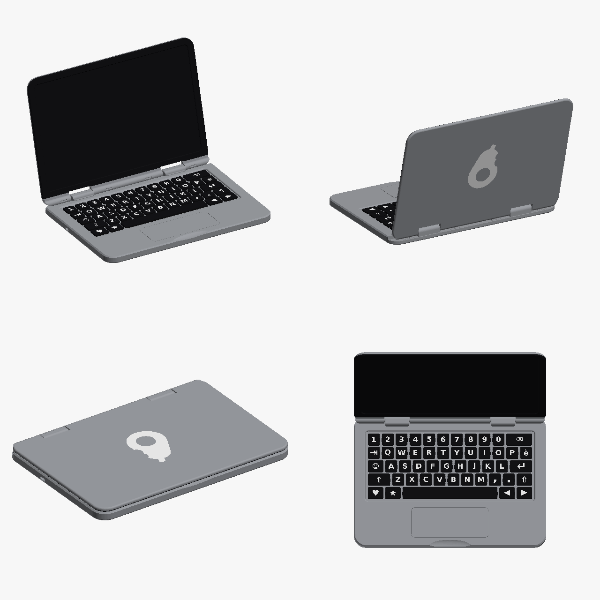

# 🥑 AvocadoBook – printable toy laptop

A realistic toy laptop, fully 3D printed and snap-fit: **50 keys that really press** (printed S-springs),
a **flush trackpad that clicks**, a **USB‑C port that grips a real cable**, a lid with a detent hinge and
**"AvocadoBook – Designed in Italy"** printed in black underneath. No screws, no glue, nothing to buy.



| | |
|---|---|
| Size | about 250 × 176 mm, screen 230 × 144 mm |
| Printer | tested on Anycubic Kobra X + ACE (4 slots); any multi-material FDM printer works |
| Materials | PETG grey · PETG white · PETG black · PLA (break-away supports only) |
| License | [CC BY-NC-SA 4.0](LICENSE) – commercial use on request |

## Print it
- **Anycubic Slicer Next:** open [`print/AvocadoBook_progetto.3mf`](print/AvocadoBook_progetto.3mf) – 7 plates,
  slots and settings ready (slot 1 grey, 2 white, 3 black PETG, 4 PLA).
- **Other slicers:** per-plate files in [`print/plates/`](print/plates) and single parts in [`print/stl/`](print/stl).
- Settings and per-plate notes: [print sheet (EN)](docs/pdf/print_sheet_KobraX_EN.pdf) ·
  [scheda di stampa (IT)](docs/pdf/scheda_stampa_KobraX_IT.pdf).
- Optional quick test prints: [`print/tests/`](print/tests) (USB‑C port, hinge cover, bottom text).

## Assemble it
[Assembly instructions (EN)](docs/pdf/assembly_instructions_EN.pdf) ·
[Istruzioni di montaggio (IT)](docs/pdf/istruzioni_montaggio_IT.pdf) · about 30 minutes, adult assembly.
Springs into the bottom → keys and trackpad → lid hinge into the bottom, opened to at least 105° → top case snaps on.
For the screen picture use [`docs/pdf/modello_foglio_schermo_A4.pdf`](docs/pdf/modello_foglio_schermo_A4.pdf).

⚠️ Contains small parts: not suitable for children under 3.

## Modify it
The model is fully parametric Python ([manifold3d](https://github.com/elalish/manifold), trimesh):
```
pip install manifold3d trimesh numpy matplotlib pillow rtree
python3 src/genera_laptop.py          # build/parts.pkl
python3 tools/verify.py --fast        # geometry, hinge rotation, assembly path checks
python3 src/esporta_piatti.py         # build/print: plates, STL, multi-plate project
python3 tools/check_exports.py
```
See [`CLAUDE.md`](CLAUDE.md) for the design rules learned from the test prints, and [`TODO_v2.md`](TODO_v2.md)
for open issues and ideas.

## Credits
Designed by **Marketto**, with the help of an AI assistant (Claude by Anthropic) that wrote the parametric CAD code;
idea, design decisions and dozens of test prints by the author.
